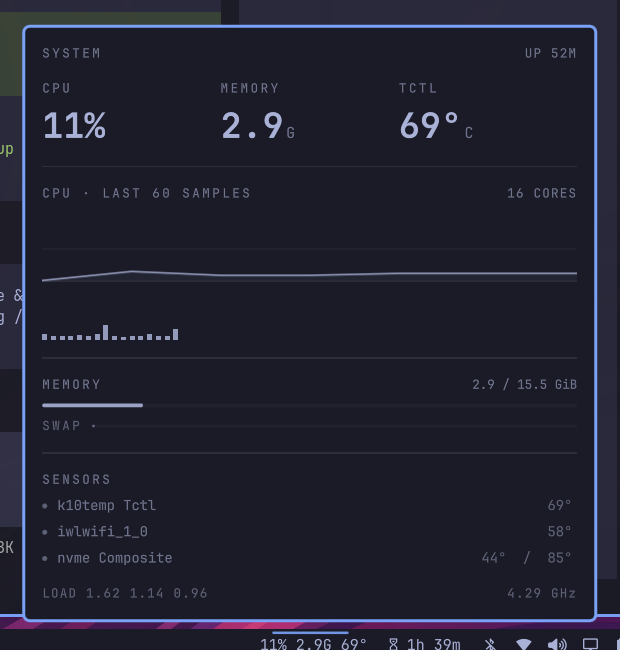

# kb.system-pulse

Minimal CPU / RAM / temperature review for the Omarchy bar. Monochrome by
design — typography, hairlines, and the theme palette only; `urgent` is the
single hue allowed in, and only when something needs attention.

## What it does

**Bar pill** — one glyph plus a compact read-out, e.g. `` 23% 9.4G 66°``.

- left click → review popup
- right click → icon-only mode (persisted to shell.json)
- middle click → launch btop (`middleAction`)
- pill text flips to the theme's urgent color on cpu ≥ 98%, mem ≥ 97%, or a
  sensor past its hot threshold

**Review popup**

- Hero triptych: CPU % · memory GiB · primary temperature
- CPU sparkline over the last N samples with per-core vertical load strip
- Memory track + swap row (swap only when the machine has any)
- Sensor list from every readable `hwmon` input, hottest first, each with a
  severity dot and its critical threshold; overflow folded into "+N more"
- Footer: load averages and current max core frequency

Data comes from `/proc/stat`, `/proc/meminfo`, `/proc/loadavg`, cpufreq, and
`/sys/class/hwmon` via `scripts/sysprobe` — no extra packages. Percentages are
computed from jiffie deltas between ticks; history is kept in-memory only.

## Install

```bash
omarchy plugin add https://github.com/KabirBhattarai/omarchy-system-pulse --enable
```

Or from an existing clone:

```bash
omarchy plugin enable kb.system-pulse right
```

The widget mounts in the right bar section. Left click opens the review popup.

## Remove

```bash
omarchy plugin disable kb.system-pulse     # take the widget off the bar
omarchy plugin remove kb.system-pulse      # delete the installed copy
```

If you installed it by cloning into `~/.config/omarchy/plugins/kb.system-pulse/`
manually, disable it first, then delete that folder and remove its entry from
the `bar.layout` section of `~/.config/omarchy/shell.json`.

## Dependencies

None beyond a stock Omarchy install:

- `bash` — runs `scripts/sysprobe` (ships with Arch)
- kernel interfaces — `/proc/stat`, `/proc/meminfo`, `/proc/loadavg`,
  `/proc/uptime`, cpufreq sysfs, `/sys/class/hwmon`; all exposed by the
  standard Linux kernel, no extra packages
- optional: `btop` for the default middle-click action (already ships with
  Omarchy; change or empty `middleAction` to disable)

The plugin never writes to your configuration; the only file it modifies is
its own entry in `~/.config/omarchy/shell.json` when you toggle icon-only mode
via right-click.

## Preview



## Settings

All settings are inline keys on the widget's entry in
`~/.config/omarchy/shell.json`:

| key           | default                        | meaning                              |
|---------------|--------------------------------|--------------------------------------|
| `interval`    | `2`                            | seconds between samples              |
| `history`     | `60`                           | sparkline sample count (20–240)      |
| `showCpu`     | `true`                         | include CPU % in the bar label       |
| `showRam`     | `true`                         | include used GiB in the bar label    |
| `showTemp`    | `true`                         | include temperature in the bar label |
| `tempUnit`    | `"C"`                          | `"F"` for Fahrenheit                 |
| `warmAt`      | `70`                           | warm threshold °C                    |
| `hotAt`       | `88`                           | urgent threshold °C                  |
| `sensorRows`  | `6`                            | max rows in the popup sensor list    |
| `iconOnly`    | `false`                        | start collapsed to the glyph         |
| `middleAction`| `"omarchy-launch-or-focus-tui btop"` | command for middle click       |

Example entry:

```json
{ "id": "kb.system-pulse", "interval": 3, "tempUnit": "F", "hotAt": 90 }
```

## IPC

```bash
omarchy-shell kb.system-pulse toggle
omarchy-shell kb.system-pulse status
```

## License

MIT — see [LICENSE](LICENSE).

## Files

- `BarWidget.qml` — pill + sampling loop + popup host
- `Panel.qml` — review popup
- `Model.js` — pure parse/format/threshold helpers
- `scripts/sysprobe` — single-line JSON snapshot of the machine
